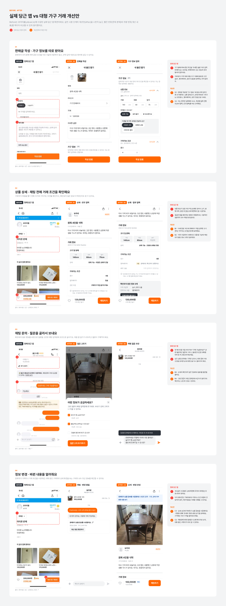

# Before · After — 실제 당근 앱 vs 대형 가구 거래 개선안

Before는 유아이볼(uibowl.io)에 수집된 실제 당근 앱 화면이고, After는 이 프로토타입의 개선안 화면이에요.
Figma의 **🔍 Before · After** 페이지에서 같은 사용 단계끼리 나란히 놓고, 빨간 번호(현재 문제)와 주황 번호(개선 내용)를 짝지어 비교할 수 있어요.

- Figma: https://www.figma.com/design/xnNSJ8qp0ZOUsP9icENp23?node-id=127-3

| # | 흐름 | Before (유아이볼) | 현재 문제 | After | 개선 내용 |
|---|---|---|---|---|---|
| 01 | 판매글 작성 | [당근 글쓰기](https://uibowl.io/name/%EB%8B%B9%EA%B7%BC?patterns=%EA%B8%80%EC%93%B0%EA%B8%B0&imgId=cm49e5eqo003vl70ck5i87zcs) · [이미지](before-01-write.jpg) | 크기·분해·운반 조건을 '자세한 설명' 자유 입력에만 쓸 수 있고, 대형 가구 거래 조건 입력 칸이 없어요. | S2, S3 | '가구 정보' 섹션을 선택 입력으로 추가하고, 섹션별 입력 진행도를 보여줘요. |
| 02 | 상품 상세 | [당근 상세정보](https://uibowl.io/name/%EB%8B%B9%EA%B7%BC?patterns=%EC%83%81%EC%84%B8%EC%A0%95%EB%B3%B4%20%28PDP%29&imgId=cm49g7obj001alb0cwgpj9hly) · [이미지](before-02-detail.jpg) | 상품 정보가 본문 텍스트에만 있고, 확인 방법이 채팅뿐이에요. | B1, B2 | '거래 정보' 카드로 정리하고, '아직 미입력'과 '판매자도 모름'을 구분해 보여줘요. |
| 03 | 채팅 문의 | [당근 채팅](https://uibowl.io/name/%EB%8B%B9%EA%B7%BC?patterns=%EC%B1%84%ED%8C%85&imgId=cm49gteyu0040lc0chs4r1ncb) · [이미지](before-03-chat.jpg) | 첫 질문을 직접 써야 하고, 대화 중에 거래 조건을 볼 수 없어요. | B3, B4 | 확인되지 않은 정보에서 질문을 고르면 입력창에 초안으로 들어가요. |
| 04 | 정보 변경 | [당근 상세정보](https://uibowl.io/name/%EB%8B%B9%EA%B7%BC?patterns=%EC%83%81%EC%84%B8%EC%A0%95%EB%B3%B4%20%28PDP%29&imgId=cm49g7obj001alb0cwgpj9hly) · [이미지](before-02-detail.jpg) | 게시글이 수정돼도 무엇이 바뀌었는지 알 수 없어요. | C2, C3 | 상세 상단 변경 안내와 채팅 시스템 메시지로 변경 항목을 알려줘요. |

Before 이미지는 유아이볼의 미리보기 해상도(296×640)예요. 원본 화면은 표의 유아이볼 링크에서 볼 수 있어요.
